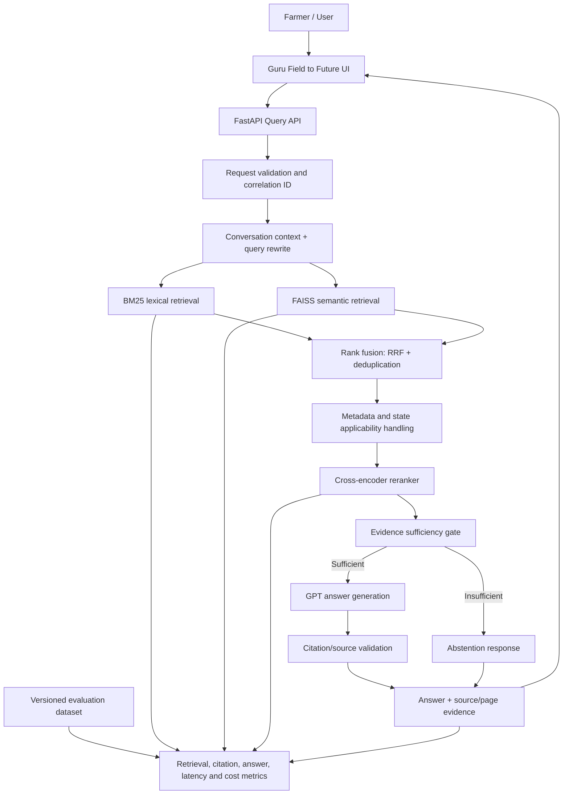

# Guru Enhancements — Architecture Proposal

**Version:** 0.1  
**Status:** Proposed architecture — not approved for implementation  
**Date:** 15 November 2026

## 1. Architecture principles

1. Keep the original `guru_ai` project and its storage untouched.
2. Build the enhancement application in the separate `guru_ai_enhancements` directory.
3. Preserve the existing separation between UI and FastAPI backend unless approved design review finds a reason to change it.
4. Keep source/page metadata intact end-to-end.
5. Evaluate each retrieval stage against a fixed dataset before selecting final models or thresholds.
6. Prefer configurable components over hard-coded model choices.
7. Benchmark local reranking on the Intel Mac (16 GB RAM) before fixing the model.

## 2. Existing baseline architecture (source-reviewed)

| Layer | Current component | Current behaviour |
|---|---|---|
| UI | Streamlit `app.py` | Farmer profile, language, upload, chat, eligibility guidance and knowledge-base tabs |
| API | FastAPI `api/main.py` | Health, knowledge-base, ingest and query endpoints |
| PDF extraction | `PyPDFLoader` | Extracts machine-readable text page-by-page; scanned image OCR is not implemented |
| Chunking | `RecursiveCharacterTextSplitter` | Uses configured chunk size and overlap, preserving page metadata |
| Embeddings | OpenAI embeddings | Converts document chunks and query to vectors |
| Vector retrieval | FAISS | Semantic similarity search with configured `TOP_K` |
| State handling | Metadata filtering in `core/rag.py` | State preference is applied after initial top-K retrieval; All India/central sources can be retained |
| Generation | `ChatOpenAI`, GPT-4o-mini by default | Generates response from retrieved context, profile and recent conversation history |
| Persistence | Local `data/pdfs/`, `storage/faiss_index/`, `storage/manifest.json` | Documents and local index are persisted for the baseline |

Existing API paths:

- `GET /health`
- `GET /api/v1/knowledge-base`
- `POST /api/v1/ingest`
- `POST /api/v1/query`

## 3. Proposed target architecture



## 4. Proposed pipeline stages

### 4.1 Conversation-aware query construction

- Accept original question, recent chat turns and farmer profile.
- If the question is context-dependent, generate a standalone retrieval query.
- Retain both `original_question` and `rewritten_query`.
- Do not use profile data to supply facts missing from scheme documents.
- If rewriting fails, fall back to the original question and record a diagnostic event.

### 4.2 Hybrid retrieval

- BM25 returns lexically relevant chunks.
- FAISS returns semantically relevant chunks.
- Apply applicable state/category constraints in a way that preserves relevant All India evidence.
- Combine ranked candidates using Reciprocal Rank Fusion (RRF), subject to approval.
- Deduplicate by stable chunk identity, not only text content.
- Preserve source filename, page, state, category, document ID and chunk ID.

### 4.3 Reranking

- Rerank the fused candidate pool with a configurable cross-encoder.
- Select the final context set using an approved top-N policy.
- Benchmark candidate models for relevance, CPU latency, RAM and installation compatibility in the shared Python 3.12 environment.
- A local CPU model is preferred initially for the target Mac, but final model choice is open until benchmarked.

### 4.4 Evidence gate and generation

- Evaluate retrieved support before calling the generation model.
- Calibrate thresholds using labelled relevant/irrelevant examples.
- Do not interpret raw FAISS distances or uncalibrated model scores as a probability of correctness.
- If evidence is weak, absent, contradictory or out of scope, abstain or explain exactly what is missing.
- Generate with the original user question and the retrieved evidence; preserve source IDs.
- Validate that citations refer to returned evidence before rendering.

### 4.5 Evaluation and diagnostics

- Version dataset, source corpus manifest, prompts, embedding/reranker model identifiers and configuration.
- Measure lexical, semantic and hybrid retrieval separately.
- Compare pre-rerank and post-rerank ranking.
- Measure answer support, citation accuracy, abstention quality, latency and estimated API/local inference cost.
- Log correlation ID and stage timings without logging secrets or unnecessary profile data.

## 5. Proposed API evolution

The existing routes should be preserved where practical. Potential additive response/diagnostic fields may include:

- `original_question`
- `rewritten_query` (diagnostic, may be hidden from normal users)
- `retrieval_sources` / retrieval strategy
- `citations` with stable document/chunk identifiers
- `abstained` and a controlled `retrieval_note`
- `pipeline_timings` for authorised diagnostic/evaluation contexts

The exact public schema must be finalised during detailed design. Do not expose internal confidence scores as correctness probabilities.

## 6. Proposed enhanced project structure

```text
guru_ai_enhancements/
├── README.md
├── docs/
├── api/                 # empty scaffold until approval
├── core/                # empty scaffold until approval
├── ui/                  # empty scaffold until approval
├── tests/               # empty scaffold until approval
├── data/pdfs/           # separate enhanced-project documents
└── storage/             # separate indexes/manifests
```

No source code, `requirements.txt` or `.env` is included in this requirements pack.

## 7. Environment and data isolation

- From `guru_ai_enhancements`, activate the shared environment using `source ../venv312/bin/activate` (assuming the sibling folder layout under `GenAICourse`).
- Do not create `guru_ai_enhancements/.venv` by default.
- Keep `guru_ai_enhancements/.env` separate from `guru_ai/.env`.
- Use project-root-relative paths for all enhanced PDFs and indexes.
- Do not set `DATA_DIR` or `STORAGE_DIR` to any path under `guru_ai`.
- Do not read, migrate or overwrite the existing FAISS index. Re-upload or copy permitted source PDFs into the new project's own data location when authorised.

## 8. Design decisions and open items

| Item | Proposed decision | Status |
|---|---|---|
| UI framework | Retain Streamlit initially, but use a reusable design system; consider a custom accessible select component if native dropdown styling fails | Review |
| API framework | Retain FastAPI initially | Proposed |
| Lexical search | BM25 | Proposed |
| Semantic search | FAISS | Proposed |
| Fusion | Reciprocal Rank Fusion | Proposed |
| Reranking | Configurable cross-encoder; CPU benchmark required | Review |
| Evidence gate | Calibrated threshold plus rule-based evidence checks | Review |
| Evaluation | Versioned labelled dataset and repeatable report | Proposed |
| Data store | Local, separate storage for first enhancement build | Proposed |

## 9. Architecture exit criteria

Before implementation, approve the target diagram, model choices or benchmark plan, API schema changes, index rebuild/migration approach, data isolation, observability fields and failure handling.
