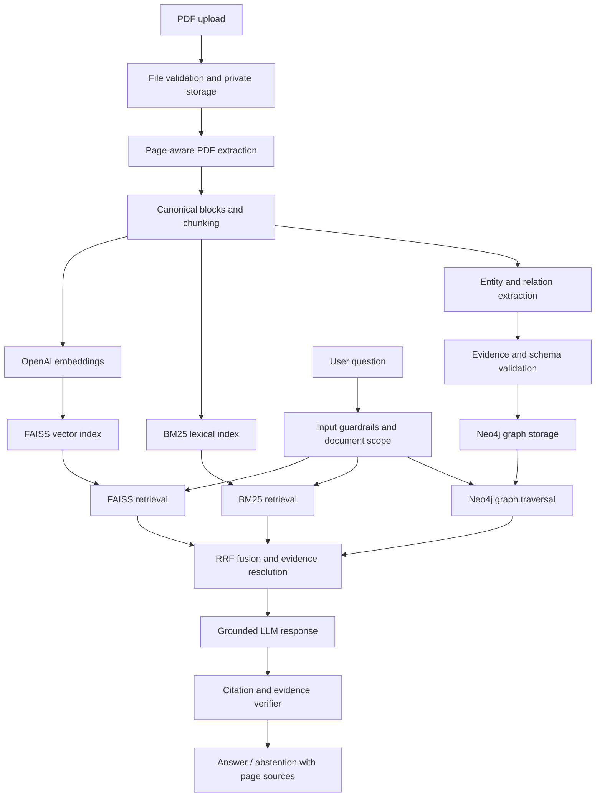

# PDF Intelligence Assistant — v0.1.0

A document-scoped PDF summarization and question-answering application built around two ingestion pipelines and hybrid retrieval.

**Current release classification:** local development / integration-validation build. It is not yet certified or ready for public production deployment. See `docs/VALIDATION_REPORT.md` for executed checks and `docs/SECURITY_AND_RELEASE_GATE.md` for required release blockers.

## What it does

1. Upload and validate a PDF.
2. Extract page-aware blocks and create canonical document/chunk records.
3. Run two separate ingestion pipelines:
   - **Vector + lexical:** structure-aware chunking → OpenAI embeddings → FAISS; parallel BM25 index.
   - **Knowledge graph:** LLM-assisted entity/relation extraction → exact-quote/schema validation → Neo4j graph storage with page/chunk provenance.
4. If native text yield is low or OCR is used/uncertain, pause in `EXTRACTION_REVIEW_REQUIRED`; a user must inspect the saved passages and explicitly approve indexing. Neither pipeline runs before approval.
5. Allow Q&A and summaries only when both required pipelines report `READY`.
6. At query time, retrieve from FAISS, BM25 and Neo4j in parallel; combine rankings using Reciprocal Rank Fusion (RRF).
7. Generate PDF-grounded answers and hierarchical summaries with page references; reject invalid citations and run a separate evidence-verification pass.
8. Abstain when evidence is missing, invalid or cannot be verified.

The uploaded `sample_documents_spotify_web_app_architecture.pdf` is a test document. It describes a **Spotify-like web app architecture**; this project does not build Spotify or claim that the PDF represents Spotify's real internal architecture.

## Architecture at a glance



## Technology

- Python 3.12
- FastAPI backend and Streamlit UI
- LangChain integrations (`langchain-openai`, `langchain-community`)
- OpenAI GPT-4o-mini and configurable OpenAI embeddings
- FAISS dense vector index
- BM25 lexical search
- Neo4j graph database
- PyMuPDF PDF extraction; optional Tesseract OCR for scanned pages
- SQLite metadata repository for the local development build
- Docker Compose for local container orchestration
- pytest and a sample-document golden evaluation set

## Project structure

```text
pdf_intelligence_assistant_project/
├── app/
│   ├── api/main.py                 # FastAPI endpoints and workspace authorization
│   ├── core/                       # configuration and security helpers
│   ├── services/
│   │   ├── pdf_extractor.py        # page-aware PDF extraction / optional OCR
│   │   ├── chunking.py             # stable provenance-aware chunks
│   │   ├── vector_pipeline.py      # FAISS + BM25
│   │   ├── graph_pipeline.py       # entity/relation extraction and Neo4j
│   │   ├── retrieval.py            # parallel retrieval orchestration
│   │   ├── fusion.py               # reciprocal rank fusion
│   │   ├── answering.py            # grounded Q&A and citation verification
│   │   ├── summarization.py        # hierarchical summaries
│   │   ├── guardrails.py           # input, graph and citation validation
│   │   └── repository.py           # workspace-scoped SQLite metadata
│   └── ui/streamlit_app.py         # upload, summary, chat, evidence and delete UI
├── docs/                           # approved v0.1 requirements + implementation notes
├── evals/                          # golden questions grounded in sample PDF
├── scripts/run_golden_eval.py      # API-based smoke evaluation
├── tests/                          # offline automated tests
├── sample_documents_spotify_web_app_architecture.pdf
├── Dockerfile
├── docker-compose.yml
├── requirements.txt
└── .env.example
```

## Prerequisites

- Python 3.12 recommended.
- OpenAI API key with access to the configured chat and embedding models.
- Neo4j AuraDB or self-hosted Neo4j credentials.
- Docker Desktop for the easiest local run, or a local Python environment plus a running Neo4j instance.
- Tesseract binary only when OCR is enabled. The Docker image installs English Tesseract; other OCR languages need their language packs.

## Safe setup using the existing `venv312`

The requirements may affect shared packages. **Do not install them until the dry-run output has been reviewed.** From the project directory:

```bash
cd ~/GenAICourse/pdf_intelligence_assistant_project
source ../venv312/bin/activate
python --version
python -m pip check
python -m pip install --dry-run -r requirements.txt
```

Share the full dry-run output before running a real install. Do not create another virtual environment unless the dependency review shows that using the shared environment is unsafe and a separate environment is explicitly approved.

After dependencies are approved and installed:

```bash
cp .env.example .env
```

Edit `.env` and provide:

```dotenv
OPENAI_API_KEY=your-openai-key
NEO4J_URI=bolt://localhost:7687
NEO4J_USERNAME=neo4j
NEO4J_PASSWORD=your-neo4j-password
```

Never paste API keys in chat, commit `.env`, or include credentials in screenshots.

## Run with Docker Compose

1. Set `NEO4J_PASSWORD` and `OPENAI_API_KEY` in `.env`.
2. Keep `APP_ENV=development` for local validation.
3. Start the services:

```bash
docker compose up --build -d
```

4. Open:
   - Streamlit UI: `http://localhost:8502`
   - FastAPI docs: `http://localhost:8001/docs`
   - Neo4j Browser: `http://localhost:7474`
5. Upload `sample_documents_spotify_web_app_architecture.pdf` in the UI.
6. Wait until **overall status**, **vector pipeline**, and **knowledge graph** all show `READY`.
7. Generate an executive/detailed summary and ask questions such as:
   - Which frontend technologies are listed?
   - What does the Playback & Session Service manage?
   - Which databases and storage systems are listed?
   - Does the PDF state the CEO's salary? (Expected: abstain.)

Stop services:

```bash
docker compose down
```

To remove the Neo4j volume, which permanently deletes the local graph data:

```bash
docker compose down -v
```

## Run without Docker

With the dependencies installed and Neo4j reachable:

Terminal 1:

```bash
uvicorn app.api.main:app --reload --host 0.0.0.0 --port 8001
```

Terminal 2:

```bash
streamlit run app/ui/streamlit_app.py --server.port 8502
```

## API endpoints

| Method | Endpoint | Purpose |
|---|---|---|
| GET | `/health/live` | Liveness check |
| GET | `/health/ready` | Configuration/storage readiness indicators |
| GET | `/api/v1/documents` | List documents within the authenticated workspace |
| POST | `/api/v1/documents` | Validate, store and enqueue PDF ingestion |
| GET | `/api/v1/documents/{id}` | Read document and pipeline status |
| POST | `/api/v1/documents/{id}/retry` | Retry failed ingestion |
| POST | `/api/v1/documents/{id}/approve-extraction` | Approve reviewed low-text/OCR extraction and resume indexing |
| GET | `/api/v1/documents/{id}/chunks` | Inspect extracted chunks and page references |
| POST | `/api/v1/ask` | PDF-grounded Q&A |
| POST | `/api/v1/summaries` | Executive, detailed or section summary |
| DELETE | `/api/v1/documents/{id}` | Delete local and graph-derived document data |

All `/api/v1` endpoints require `Authorization: Bearer <API_KEY>`.

## Authentication and workspace scoping in v0.1

- Development mode supplies a single local workspace key: `local-dev-key-change-before-deployment`.
- `API_KEYS_JSON` maps API keys to workspace IDs. Use randomly generated keys of at least 32 characters.
- All metadata, chunk lookup, local index paths and Neo4j queries are scoped by the authenticated workspace and selected document.
- This is an initial API-key workspace boundary, **not a complete enterprise OIDC/SSO implementation**. Production identity integration remains a release blocker.

Example production mapping (store in a secret manager, not source control):

```dotenv
API_KEYS_JSON='{"replace-with-32-plus-random-characters":"workspace-a"}'
```

## Evaluation and tests

Offline unit tests:

```bash
pytest -q
python -m compileall -q app tests scripts
```

The initial test set covers:
- RRF rank fusion and duplicate handling;
- page/document provenance in chunking;
- Tamil Unicode tokenization;
- strict graph evidence quote/type checks;
- prompt-override input checks;
- citation ID scoping;
- SQLite workspace isolation and duplicate detection;
- extraction of the six-page sample PDF;
- basic retrieval/citation/abstention metric calculations.

After the sample PDF reaches `READY`, run the live smoke evaluation:

```bash
export EVAL_DOCUMENT_ID="<document-id-from-the-ui-or-api>"
python scripts/run_golden_eval.py
```

The golden dataset is `evals/sample_spotify_questions.jsonl`. Its API evaluation is a smoke test; it is not a substitute for human-judged faithfulness, adversarial testing, load testing or a production release gate.

## Current limits and known decisions

- Both pipelines are required for `READY`. If OpenAI embeddings or Neo4j graph extraction/storage fails, Q&A stays disabled and the failed pipeline is shown.
- OCR is optional (`OCR_ENABLED=true`); native text extraction is the default. Low native-text yield, OCR-derived text or OCR failures pause in `EXTRACTION_REVIEW_REQUIRED`; review the saved page-linked chunks and explicitly approve before indexing.
- Reranking is not active. `RERANKER_ENABLED` remains false; no cross-encoder is enabled until benchmarked and approved.
- Local metadata uses SQLite and local storage; production should move to approved PostgreSQL/object storage before multi-instance deployment.
- Ingestion currently uses FastAPI background tasks; a durable worker/queue is required for production workloads.
- Graph extraction is LLM-assisted and filtered by schema, exact quote and endpoint validation; human review and accuracy measurement are still required for high-stakes use.
- FAISS LangChain persistence uses a local pickle docstore; the index directory must be private and writable only by the application service.
- The `health/ready` route reports configuration readiness, not a full end-to-end provider query.
- The project has not yet been integrated on your Mac, tested with your credentials, security-certified, or deployed to a live environment.

## Change control

The approved requirements pack is in `docs/`. Scope, storage, identity, retention, deployment, model, cost or privacy changes must be recorded and approved before implementation. Do not modify `guru_ai` or `guru_ai_enhancements` as part of this project.
