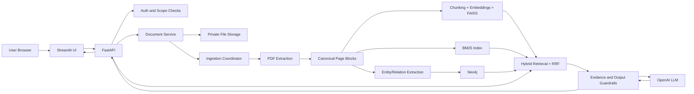

# Technical Architecture

## 1. Architectural principles

- Evidence first: the PDF is the source of truth for document-scoped answers.
- Dual representation: build both searchable chunks and a provenance-aware graph.
- Isolation by design: ownership and document scope are enforced in every storage and retrieval path.
- Failure transparency: one successful pipeline must not hide the failure of the other.
- Reproducibility: version parsers, chunking, embeddings, prompts, graph schema and indexes.
- Production separation: API requests, background ingestion, storage and observability are distinct concerns.

## 2. Proposed technology

| Layer | Technology | Responsibility |
|---|---|---|
| Language | Python 3.12 | Main application and workers |
| UI | Streamlit | Upload, progress, summary, chat, evidence inspection |
| API | FastAPI | Authentication integration, document, ingestion and query APIs |
| Orchestration | LangChain components / explicit Python services | Loader, splitting, embeddings, retrieval and LLM orchestration |
| LLM | OpenAI GPT-4o-mini | Extraction assistance, summaries and grounded answers |
| Embeddings | OpenAI embedding model (configurable) | Semantic representations |
| Vector index | FAISS | Dense similarity retrieval |
| Lexical retrieval | BM25 | Exact keyword retrieval |
| Graph database | Neo4j AuraDB or self-hosted Neo4j | Entities, relations and provenance |
| PDF parsing | PyMuPDF and/or PyPDF | Text and page extraction; choice benchmarked on sample corpus |
| OCR | Tesseract or approved OCR service | Scanned-page text extraction |
| Container | Docker | Reproducible packaging and deployment |
| QA | pytest and evaluation scripts | Unit, integration, security and RAG quality checks |

Optional production services (not yet fixed): PostgreSQL for identity/document/job metadata; Redis and a queue for job dispatch; object storage for original PDFs and exports; OpenTelemetry-compatible tracing and Prometheus/Grafana metrics.

## 3. High-level components

1. **Streamlit frontend:** Upload and manage documents, show stage progress, summary modes, chat and evidence panels.
2. **FastAPI application:** Validates requests, authenticates users, authorizes document scope and returns job/query results.
3. **Document service:** Stores metadata and original files, calculates hashes, manages versions and deletion.
4. **PDF extraction service:** Produces canonical page-aware blocks and extraction quality signals.
5. **Ingestion coordinator:** Starts and tracks two independent pipeline jobs, retries safe failures and calculates overall readiness.
6. **Vector/lexical indexer:** Structure-aware splitting, embeddings, FAISS persistence and BM25 indexing.
7. **Graph extractor/indexer:** Typed entity and relation extraction, validation, entity resolution, Neo4j writes.
8. **Retrieval orchestrator:** Parallel FAISS, BM25 and graph retrieval; provenance resolution; RRF; optional reranker.
9. **Guardrail service:** Upload checks, scope checks, prompt-injection handling, evidence and output validation.
10. **Summary/Q&A service:** Prompt composition with selected evidence and citations; abstention behavior.
11. **Evaluation service:** Curated test datasets, metrics, run metadata and regression gates.
12. **Observability/operations:** Logs, metrics, health/readiness and audit events.

## 4. Dual ingestion pipeline

### Shared pre-processing

`PDF upload → file validation → secure storage → parsing → page-aware canonical blocks → extraction quality gate → canonical document representation`

The canonical representation must preserve:
- `workspace_id`, `document_id`, `document_version_id`
- page number and source block order
- heading/section path, text block type and table/list metadata when available
- extracted text and source offsets where available
- extraction method (native text or OCR), parser version and quality metadata
- content hash and stable IDs

### Pipeline A: Vector + lexical indexing

`Canonical blocks → section-aware chunking → stable chunk IDs → embeddings → FAISS index`

In parallel: `Canonical chunks → normalized lexical tokens → BM25 index`

Chunking shall avoid splitting headings from their content where feasible and shall preserve page provenance. Chunk size and overlap are configuration values to be tuned against retrieval evaluation, not arbitrary constants. Index metadata must allow workspace/document/version filtering and retrieval of original passages. BM25 and FAISS indexes must be rebuilt deterministically from canonical chunks.

### Pipeline B: Knowledge Graph

`Canonical blocks/chunks → candidate entity extraction → candidate relation extraction → schema validation → evidence validation → entity resolution → Neo4j graph storage`

Each graph mention/fact must include provenance. A relationship is stored only if the source passage supports it. If the text says that service A uses database B, the relation may be `USES` or `STORES_DATA_IN` only according to the schema and supporting text. Do not infer a dependency merely because two components appear near each other in a list.

Neo4j labels and relationship types must be allowlisted. Dynamic values are parameters. Generated Cypher shall not permit write operations from a user-facing read query path.

## 5. Hybrid retrieval and generation

1. Authenticate caller and resolve active workspace/document scope.
2. Validate and normalize the question; detect prompt injection and off-topic requests.
3. Build retrieval plan: vector search, BM25 search and graph search where entities/relations are relevant.
4. Execute all searches with scope filters; each result carries stable chunk ID and provenance.
5. Convert graph facts to supporting source passages; graph facts without valid source evidence cannot support an answer.
6. Deduplicate candidates and combine ranked lists using RRF. Preserve retrieval source and scores for observability.
7. Optionally rerank top candidates only after benchmark approval; default disabled.
8. Apply evidence threshold, diversity and conflict checks.
9. Build a bounded context containing only selected evidence and clear instructions that the evidence is untrusted data.
10. Generate a concise answer and structured citations.
11. Verify citations point to the active document/version and supported page passages. Repair once or abstain if validation fails.
12. Return answer, citations, evidence snippets and relevant retrieval diagnostics (without leaking internals unnecessarily).

### RRF

For candidate item `d`, standard RRF score is:

`RRF(d) = Σ_i 1 / (k + rank_i(d))`

where `rank_i` is the item's rank in a retrieval list and `k` is a configurable constant. If a graph result maps to several supporting chunks, the mapping policy must be fixed and evaluated. Do not combine incomparable raw similarity scores directly.

## 6. Summary architecture

- Short/overview summary: summarize relevant document evidence with citations.
- Detailed summary: hierarchical summarization across sections/pages, retaining source references through intermediate summaries.
- Section summary: summarize one selected heading/section.
- Key points: extract concise claims, each linked to page(s).
- Summary validators check coverage, unsupported claims, and citation integrity.

## 7. Deployment topology (logical)

## 8. Ingestion state model

Suggested states: `UPLOADED`, `VALIDATING`, `EXTRACTING`, `EXTRACTION_REVIEW_REQUIRED`, `INDEXING_VECTOR`, `INDEXING_GRAPH`, `READY`, `READY_WITH_WARNINGS`, `FAILED_RETRYABLE`, `FAILED_FINAL`, `DELETING`, `DELETED`.

Track vector and graph pipeline state separately. A document is `READY` only when both required pipelines are complete and all required validations pass. `READY_WITH_WARNINGS` is allowed only under an explicit policy defining which non-critical warnings still permit Q&A.

## 9. Consistency, retries and deletion

- Stage writes must be idempotent using document version and stage version keys.
- A retry must not duplicate chunks, entities or relationships.
- Index manifests shall identify the exact canonical source and configuration versions.
- Deletion must remove or tombstone original files, vector/lexical indexes, graph nodes/edges, summaries, caches and exports according to retention/legal-hold policy.
- If cross-store deletion partially fails, mark the document deletion as pending and retry; do not report success until all required stores confirm completion.

## 10. Decisions still requiring confirmation

See `ASSUMPTIONS_DECISIONS.md` for auth provider, metadata store, object storage, deployment target, OCR choice, retention policy, supported file limits and model/embedding selection.
